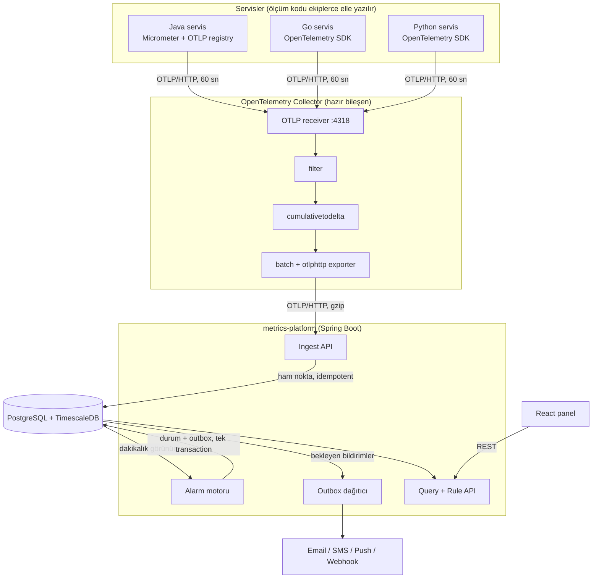

# Metot Süresi İzleme ve Eşik Alarm Platformu — Mimari Tasarım

Bu depo bir kod projesi değil, bir **mimari tasarım** deposudur. Çok dilli (Java, Go, Python) bir mikroservis ortamında, seçilen metotların çalışma sürelerini ölçen, merkezde toplayan, 1 dakika ile 12 saat arasındaki zaman pencerelerinde eşiklere göre değerlendiren ve eşik aşıldığında email, SMS, push veya webhook ile bildirim üreten bir platformun tasarımını anlatır.

Depoda kaynak kod yoktur. Bileşenlerin sorumlulukları, aralarındaki sözleşmeler, konfigürasyonlar, veri modeli, zamanlama ve hata davranışları, alınan mimari kararlar (ADR) ve bir draw.io şeması bulunur. Ayrıca bu mimariyle ilgili soruları yanıtlamak ve değişiklikleri değerlendirmek için kullanılabilecek bir Claude skill dosyası vardır.

## Ne işe yarar

Bir mikroservis yavaşladığında bunu çoğu zaman kullanıcılar fark eder; ekip fark ettiğinde sorun saatlerdir sürüyordur. Bu platform, ekiplerin "bu metot kritik" diye işaretlediği noktaların süresini sürekli izler ve şu soruları otomatik olarak sorar:

- `order-service` içindeki `OrderService.createOrder` son 10 dakikada ortalama 50 ms'nin üstüne çıktı mı?
- `pricing-service` içindeki `PriceService.calculate` son 1 saatte hata oranı yüzde 2'yi geçti mi?
- Bir metodun en yüksek süresi son 12 saatte 5 saniyeyi aştı mı?

Cevap "evet" olduğunda doğru kişiye, doğru kanaldan, gereksiz tekrar olmadan bildirim gider. Sorun düzeldiğinde "çözüldü" bildirimi de aynı yoldan gider.

## Mimari bir bakışta



Akış tek cümleyle: servisler metot sürelerini bellekte toplar ve dakikada bir OTLP ile Collector'a gönderir; Collector veriyi süzer, dakikalık farka çevirir ve platforma iletir; platform ham noktaları saklar, dakikalık görünüm üzerinden alarm kurallarını her dakika değerlendirir ve bildirimleri outbox üzerinden kanallara dağıtır.

## Temel tasarım ilkeleri

1. **Ortak olan kod değil, sözleşme.** Paylaşılan kütüphane, paket deposu veya merkezi konfigürasyon servisi yoktur. Her ekip kendi servisine ölçüm kodunu elle yazar; herkesin uyduğu tek şey [ölçüm sözleşmesidir](docs/03-olcum-sozlesmesi.md).
2. **Standart protokol.** Servislerle merkez arasındaki dil OTLP'dir. Java'da Micrometer, Go ve Python'da resmi OpenTelemetry SDK'ları bu protokolü hazır konuşur.
3. **Hatalar merkezde tolere edilir.** Elle yazılan koddaki olası farklılıklar (sayaç modu, birim, eksik etiket) servislerde değil, Collector ve Ingest katmanında düzeltilir veya görünür kılınır.
4. **Neyi ölçtüğümüz servis ekibinde, neye dikkat ettiğimiz merkezde.** Ekipler ölçüm noktalarını belirler; eşikler, pencereler ve bildirim kanalları panelden yönetilen alarm kurallarıdır.
5. **Veri kaybına ve tekrar bildirime karşı tasarım.** Collector'da disk kuyruğu, Ingest'te idempotent yazma, alarmda durum makinesi, bildirimde transactional outbox.

## Belgeler

| Belge | İçerik |
|---|---|
| [01 — Genel bakış](docs/01-genel-bakis.md) | Problem, hedefler, kısıtlar, kapsam dışı konular, terimler sözlüğü |
| [02 — Mimari](docs/02-mimari.md) | Bileşenler, sorumluluklar, veri akışı, sıralı diyagram |
| [03 — Ölçüm sözleşmesi](docs/03-olcum-sozlesmesi.md) | Metrik adı, birim, etiketler, servis ekiplerinin uyması gerekenler |
| [04 — Konfigürasyon](docs/04-konfigurasyon.md) | Java, Go, Python, Collector, platform, veritabanı ve kanal ayarları (kodsuz) |
| [05 — Veri modeli](docs/05-veri-modeli.md) | Tablolar, anahtarlar, saklama süreleri, ER diyagramı |
| [06 — Alarm ve bildirim](docs/06-alarm-ve-bildirim.md) | Pencere hesabı, durum makinesi, outbox, kanallar, örnek senaryo |
| [07 — Zamanlama ve gecikme](docs/07-zamanlama-ve-gecikme.md) | Saniye saniye veri yolculuğu, hizalama, yeniden başlatma ve tekrar gönderim örnekleri |
| [08 — Hata senaryoları](docs/08-hata-senaryolari.md) | Hangi bileşen düşerse ne olur, nasıl fark edilir |
| [09 — Açık konular](docs/09-acik-konular.md) | Henüz karar verilmemiş veya ileriye bırakılmış konular |
| [ADR'ler](docs/adr/) | Mimari karar kayıtları |

## Dizin yapısı

```
.
├── README.md
├── docs/
│   ├── 01-genel-bakis.md
│   ├── 02-mimari.md
│   ├── 03-olcum-sozlesmesi.md
│   ├── 04-konfigurasyon.md
│   ├── 05-veri-modeli.md
│   ├── 06-alarm-ve-bildirim.md
│   ├── 07-zamanlama-ve-gecikme.md
│   ├── 08-hata-senaryolari.md
│   ├── 09-acik-konular.md
│   └── adr/
├── diagrams/
│   └── sistem-mimarisi.drawio
└── skills/
    └── method-latency-alerting/
        ├── SKILL.md
        └── references/
```

## Şema

[`diagrams/sistem-mimarisi.drawio`](diagrams/sistem-mimarisi.drawio) dosyası tüm sistemi tek sayfada gösterir. draw.io Desktop ile internet bağlantısı olmadan açılabilir; GitHub üzerinde ise dosyayı app.diagrams.net'te "Open from → GitHub" ile açabilirsiniz. Belgelerin içindeki şekiller Mermaid ile yazılmıştır ve GitHub'da doğrudan görüntülenir.

## Skill

[`skills/method-latency-alerting/SKILL.md`](skills/method-latency-alerting/SKILL.md), bu mimarinin özünü, değişmez kurallarını, yeni servis ekleme ve sorun giderme adımlarını içeren bir Claude skill'idir. Klasör zip'lenip Claude'a yüklendiğinde, mimariyle ilgili sorular bu tasarıma göre yanıtlanır. `references/` altındaki dosyalar `docs/` içindeki belgelerin kopyalarıdır; belge güncellendiğinde kopyalar da güncellenmelidir.

## Durum

Tasarım aşamasında. Kararlar [ADR](docs/adr/) olarak kayıt altındadır; açık konular [09 — Açık konular](docs/09-acik-konular.md) belgesindedir.
