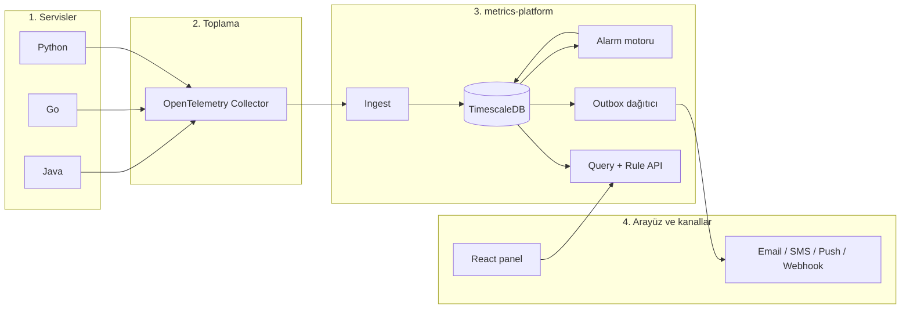
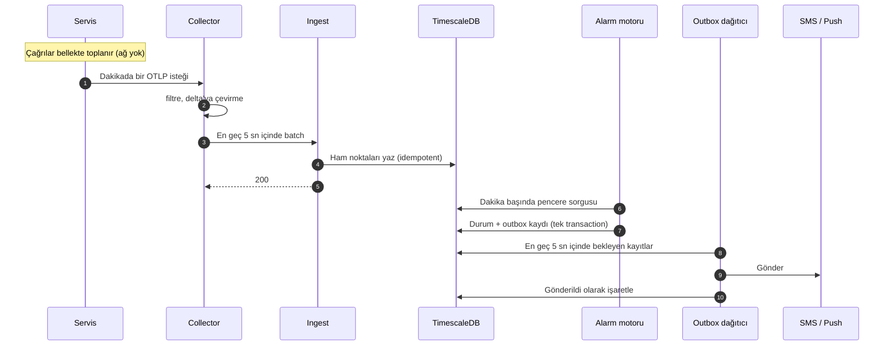

# 02 — Mimari

Sistem dört katmandan oluşur: ölçümün yapıldığı **servisler**, veriyi toplayıp normalleştiren **OpenTelemetry Collector**, saklama, değerlendirme ve bildirimden sorumlu **metrics-platform** ve kullanıcı arayüzü olan **React panel**.

## 1. Servisler

**Sorumluluk.** İşaretlenen metotların süresini ölçmek, bellekte toplamak ve 60 saniyede bir OTLP ile Collector'a göndermek.

**Nasıl ölçer.** Her metot çağrısında süre, o metoda ait bellekteki seriye eklenir: çağrı sayısı artar, toplam süre büyür, en yüksek süre güncellenir. Ağ isteği yapılmaz; maliyet nanosaniyeler mertebesindedir. Dakikada bir, tüm serilerin değeri tek bir OTLP isteğiyle gönderilir. Metot saniyede bir kez de çağrılsa, on bin kez de çağrılsa ağa giden veri aynı boyuttadır.

| Dil | Ölçüm aracı | Ölçüm noktası | Ayarların yeri |
|---|---|---|---|
| Java | Micrometer + Micrometer OTLP registry (Spring Boot otomatik kurar) | Metotta `Timer` ile süre kaydı veya `@Timed` | Servisin `application.yml` dosyası |
| Go | OpenTelemetry Go SDK | Metodun başına süreyi kaydeden tek satır | OpenTelemetry standart environment değişkenleri |
| Python | OpenTelemetry Python SDK | Ekibin kendi yazdığı küçük bir dekoratör | OpenTelemetry standart environment değişkenleri |

Ölçüm kodu her serviste ekip tarafından elle yazılır. Bütün servislerin uyduğu tek ortak kural [ölçüm sözleşmesidir](03-olcum-sozlesmesi.md).

## 2. OpenTelemetry Collector

**Ne olduğu.** OpenTelemetry projesinin hazır, açık kaynak bileşenidir. Tek bir binary veya container olarak çalışır; davranışı bir YAML dosyasıyla tanımlanır. Bu projede yazılım geliştirilmez, kurulur ve yapılandırılır. Gerekli bileşenler (filter, cumulativetodelta, disk kuyruğu) **contrib** dağıtımında bulunduğu için `otelcol-contrib` kullanılır.

**Neden var.** Servislerin tamamı tek bir sabit adrese (`otel-collector:4318`) gönderir; platformun yeri, sürümü veya geçici kesintisi servisleri ilgilendirmez. Collector aynı zamanda elle yazılan ölçüm kodundaki farklılıkları merkezde düzeltir.

**İşlem hattı (pipeline):**

| Sıra | Adım | Ne yapar |
|---|---|---|
| 1 | OTLP receiver | Port 4318'den gelen OTLP/HTTP isteklerini kabul eder |
| 2 | memory_limiter | Collector'ın bellek kullanımını sınırlar; aşırı yükte veri kabulünü yavaşlatır |
| 3 | filter | `method.duration` dışındaki tüm metrikleri atar. Spring Boot'un JVM/HTTP metrikleri burada düşer |
| 4 | cumulativetodelta | Kümülatif gelen sayaçları, her serinin bir önceki değerini hafızada tutarak dakikalık farka çevirir; servis yeniden başlatıldığında sayaç sıfırlanmasını algılar |
| 5 | batch | Noktaları en fazla 5 saniye biriktirip tek pakette gönderir |
| 6 | otlphttp exporter | Paketi metrics-platform'a OTLP/HTTP ile POST eder; başarısızlıkta tekrar dener, platform kapalıyken diskte kuyruklar |

**Ölçek ve yedeklilik.** Başlangıçta tek instance yeterlidir. cumulativetodelta adımı her serinin son değerini hafızada tuttuğu için ileride birden fazla instance çalıştırılırsa aynı servis instance'ının verisi hep aynı Collector'a gitmelidir. Ayrıntı: [08 — Hata senaryoları](08-hata-senaryolari.md), [09 — Açık konular](09-acik-konular.md).

## 3. metrics-platform

Tek bir Spring Boot uygulamasıdır; içinde birbirinden ayrık modüller bulunur. Başlangıçta tek dağıtım birimi olarak kalması bilinçli bir karardır: modüller aynı veritabanını kullanır, aralarındaki iletişim veritabanı üzerindendir, bu yüzden ileride ayrı servislere bölünmeleri kolaydır.

### Ingest API

**Girdi.** Collector'dan gelen OTLP/HTTP istekleri (`/v1/metrics`).

**İşlem.** Her nokta için servis adı, instance kimliği, sınıf adı, metot adı, sonuç (başarılı/hatalı), aralığın başlangıç ve bitiş zamanı, çağrı sayısı, toplam süre ve en yüksek süre çıkarılır. Birim milisaniyeye normalize edilir (saniye gelirse çevrilir). Sözleşmeye uymayan veri sessizce atılmaz, sözleşme ihlali olarak kaydedilir ve panelde gösterilir.

**Çıktı.** Noktalar dakikaya yuvarlanmadan, kendi aralıklarıyla birlikte ham nokta tablosuna yazılır. Benzersiz anahtar aralığın başlangıç ve bitiş zamanını içerdiği için Collector'ın tekrar gönderdiği paketler çift sayılmaz, yeniden başlatmada oluşan farklı noktalar ise kaybolmaz. Ayrıntı: [07 — Zamanlama ve gecikme](07-zamanlama-ve-gecikme.md).

**Collector'la sözleşme.** Ingest'in HTTP cevap kodu Collector'ın tekrar deneme kararını belirler:

| Durum | Cevap | Collector'ın davranışı |
|---|---|---|
| Yazma başarılı | 200 | Paketi siler |
| Paketin bir kısmı sözleşmeye uymuyor | 200 + kısmi başarı bilgisi | Reddedilen nokta sayısını loglar, tekrar göndermez |
| Paket tamamen bozuk | 400 | Tekrar göndermez |
| Veritabanı meşgul veya erişilemiyor | 503 (gerekirse `Retry-After`) | Bekleyip tekrar dener, diskte kuyruklar |

Veritabanı hatasında 400 dönmek veri kaybına yol açar; geçici hatalarda her zaman 503 dönülür.

### Veritabanı: PostgreSQL + TimescaleDB

Ham noktalar zaman bazlı bölümlenmiş (hypertable) bir tabloda 7 gün saklanır. Bu tablodan TimescaleDB'nin sürekli toplama (continuous aggregate) özelliğiyle dakikalık bir görünüm üretilir ve 30 gün saklanır. Alarm motoru ve panel bu dakikalık görünümden okur. Görünümde gerçek zamanlı toplama açıktır; henüz arka planda hesaplanmamış en yeni ham noktalar da sorgu sonucuna dahil olur. Alarm kuralları, alarm durumları, outbox ve sözleşme ihlalleri aynı veritabanındaki normal tablolardır. Ayrıntı: [05 — Veri modeli](05-veri-modeli.md).

### Alarm motoru

Her 60 saniyede bir çalışır. Aktif kuralları pencere uzunluklarına göre gruplar ve her farklı pencere için dakikalık görünüme tek bir sorgu atar. Pencere, son tamamlanmış ve verisi gelmiş dakikada biter. Her kural bir durum makinesinden geçer (normal → şüpheli → alarm); bildirim gerektiren bir geçişte alarm durumu ile outbox kaydı aynı transaction içinde yazılır. Platform birden fazla instance çalıştırırsa değerlendirme veritabanı kilidiyle tek instance'ta yapılır. Ayrıntı: [06 — Alarm ve bildirim](06-alarm-ve-bildirim.md).

### Outbox dağıtıcı

Her 5 saniyede bir outbox tablosundaki bekleyen kayıtları alır ve ilgili kanala gönderir. Kayıtları alırken satır kilidi kullanır ve kilitli satırları atlar; birden fazla dağıtıcı aynı kaydı iki kez göndermez. Başarısız gönderimler artan aralıklarla tekrar denenir; deneme sınırını aşan kayıtlar "başarısız" olarak işaretlenir ve panelde görünür.

### Query + Rule API

Panelin kullandığı REST arayüzüdür. 1 dakika ile 12 saat arası pencerelerde grafik verisi döner; çözünürlük pencereye göre ayarlanır (1 saate kadar dakikalık, 12 saatte 5–10 dakikalık noktalar). Alarm kurallarının oluşturulması, değiştirilmesi ve kapatılması da bu API üzerindendir.

### Bildirim kanalları

| Kanal | Hedef |
|---|---|
| Email | İç SMTP sunucusu |
| SMS | Kurumun SMS gateway'i (HTTP) |
| Push | React panele WebSocket üzerinden anlık bildirim |
| Webhook | Başka sistemlerin otomatik aksiyon alması için genel uç |

## 4. React panel

Metot sürelerinin grafikleri, alarm kurallarının yönetimi, aktif alarmlar, gönderilemeyen bildirimler ve sözleşmeye uymayan servisler bu arayüzde görünür.

## Bir dakikanın yolculuğu

Saniye saniye zamanlama için: [07 — Zamanlama ve gecikme](07-zamanlama-ve-gecikme.md).

## Dağıtım topolojisi

| Bileşen | Port | Kalıcı veri | Başlangıç ölçeği |
|---|---|---|---|
| otel-collector (`otelcol-contrib`) | 4318 (OTLP/HTTP), 13133 (sağlık kontrolü) | Disk kuyruğu klasörü | 1 instance |
| metrics-platform | 8090 | Yok | 1 instance (çoğaltılabilir) |
| PostgreSQL + TimescaleDB | 5432 | Veritabanı dizini | 1 instance + yedekleme |
| React panel | Statik dosyalar | Yok | Herhangi bir web sunucusu |

Tek altyapı şartı, Collector'ın servisler tarafından sabit bir DNS adıyla (`otel-collector`) erişilebilir olmasıdır.
