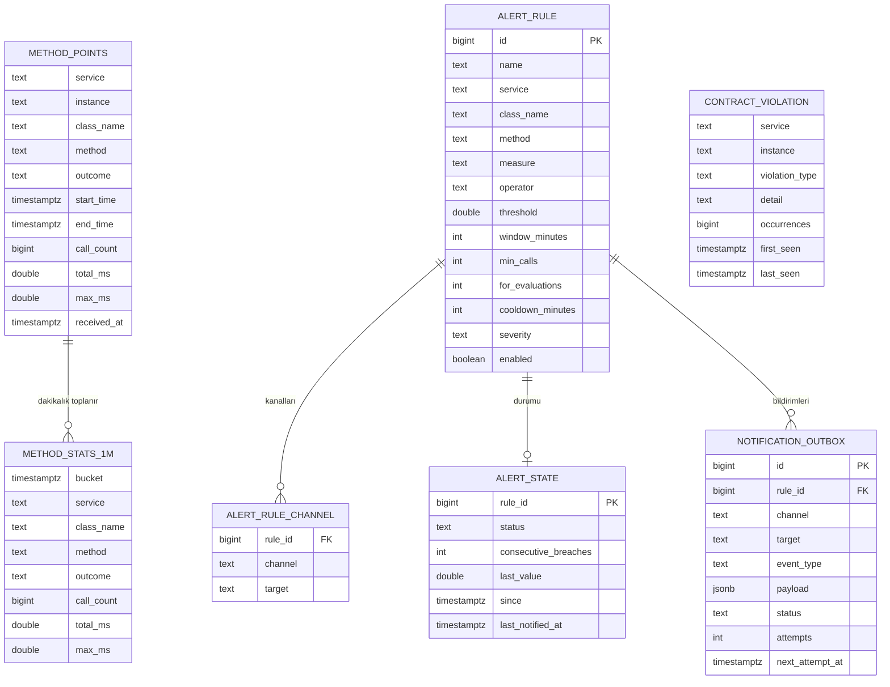

# 05 — Veri modeli

Tüm veri tek bir PostgreSQL veritabanında, TimescaleDB eklentisiyle tutulur. Bu belge tabloları ve aralarındaki ilişkileri tanımlar; SQL içermez.



## method_points — ham noktalar

Ingest'in Collector'dan gelen her noktayı dakikaya yuvarlamadan, kendi aralığıyla birlikte yazdığı tablo.

| Kolon | Anlamı |
|---|---|
| service, instance | Kaynak bilgileri (`service.name`, `service.instance.id`) |
| class_name, method, outcome | Nokta etiketleri (`code.namespace`, `code.function`, `outcome`) |
| start_time, end_time | Noktanın kapsadığı aralık |
| call_count, total_ms, max_ms | Aralıktaki çağrı sayısı, toplam süre, en yüksek süre |
| received_at | Platforma ulaştığı an; gecikme analizi için |

**Benzersiz anahtar:** service, instance, class_name, method, outcome, start_time, end_time. Collector'ın tekrar gönderdiği paket aynı anahtarı taşır ve yok sayılır; yeniden başlatmada oluşan farklı noktaların başlangıç zamanları farklıdır ve ikisi de saklanır.

**Bölümleme ve saklama:** start_time'a göre 1 günlük bölümler, 7 gün saklama.

## method_stats_1m — dakikalık görünüm

method_points'ten TimescaleDB sürekli toplamasıyla üretilir. Noktalar aralık başlangıcının dakikasına göre kovalanır; aynı kovadaki noktaların çağrı sayıları ve toplam süreleri toplanır, en yüksek süreler arasından maksimum alınır.

Instance kırılımı bu görünümde yoktur; alarm kuralları servis düzeyinde çalışır ve aynı servisin tüm kopyalarını birlikte değerlendirir. Instance bazında inceleme gerektiğinde son 7 gün için ham tabloya bakılır.

**Saklama:** 30 gün. **Yenileme:** her dakika, son 3 saat. **Gerçek zamanlı toplama:** açık.

## alert_rule ve alert_rule_channel — kurallar

Panelden yönetilen alarm kuralları ve her kuralın bildirim kanalları. Bir kural birden fazla kanala ve her kanalda birden fazla hedefe bildirim gönderebilir. Alanların açıklaması: [04 — Konfigürasyon](04-konfigurasyon.md#6-alarm-kuralları).

## alert_state — kuralların durumu

Her kural için tek satır: şu anki durum (`OK`, `PENDING`, `FIRING`), art arda kaç turdur eşiğin aşıldığı, son ölçülen değer, durumun ne zamandan beri sürdüğü ve son bildirim zamanı. Durum makinesi: [06 — Alarm ve bildirim](06-alarm-ve-bildirim.md).

## notification_outbox — gönderilecek bildirimler

Alarm motorunun durum değişikliğiyle aynı transaction'da yazdığı bildirim kayıtları.

| Kolon | Anlamı |
|---|---|
| channel, target | Kanal ve hedef (adres, telefon, kullanıcı, URL) |
| event_type | `FIRING` (alarm başladı), `REMINDER` (hatırlatma), `RESOLVED` (çözüldü) |
| payload | Bildirim içeriği: kural, servis, metot, ölçülen değer, eşik, pencere, zaman |
| status | `PENDING`, `SENT`, `FAILED` |
| attempts, next_attempt_at | Tekrar deneme bilgisi |

Bekleyen kayıtlar için sadece `PENDING` satırları kapsayan kısmi bir indeks bulunur.

## contract_violation — sözleşme ihlalleri

Sözleşmeye uymayan verinin servis, instance ve ihlal tipi bazında özetlendiği tablo. Her ihlal için ilk ve son görülme zamanı ve kaç kez görüldüğü tutulur; her nokta için ayrı satır açılmaz.

## Kilit tablosu

Platform birden fazla instance çalıştırdığında alarm değerlendirmesinin tek instance'ta yapılmasını sağlayan kayıt. ShedLock gibi bir kütüphanenin standart tablosudur.

## Kapasite

Ham nokta sayısı kabaca şöyle hesaplanır:

```
dakikalık ham nokta = servis sayısı × ölçülen metot sayısı × sonuç türü × ortalama instance sayısı
```

Örnek: 20 servis, servis başına 30 metot, 2 sonuç türü (hata yoksa ERROR serisi oluşmaz, bu bir üst sınırdır), ortalama 3 instance:

| | Dakika | Gün | Saklama boyunca |
|---|---|---|---|
| Ham nokta | 3 600 | ~5,2 milyon | 7 günde ~36 milyon |
| Dakikalık görünüm | 1 200 | ~1,7 milyon | 30 günde ~52 milyon |

TimescaleDB için bu hacimler küçüktür; sıkıştırma açıldığında disk kullanımı belirgin şekilde azalır. Sayılar büyüdükçe ilk ayarlanacak şey ham veri saklama süresi ve sıkıştırmadır.
