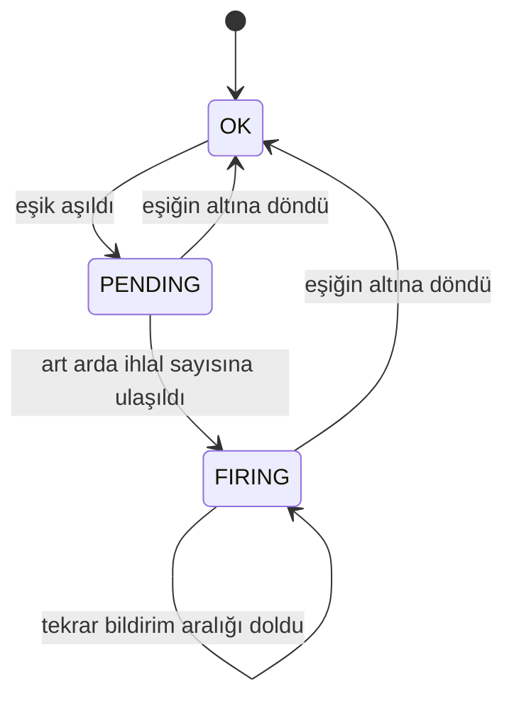

# 06 — Alarm ve bildirim

## Değerlendirme döngüsü

Alarm motoru her dakika başında çalışır. Bir turda şunları yapar:

1. Etkin kuralları okur ve pencere uzunluklarına göre gruplar. 200 kural çoğu zaman 5–6 farklı pencereye karşılık gelir; her pencere için dakikalık görünüme tek bir sorgu atılır.
2. Her pencerenin sonunu belirler: içinde bulunulan dakika henüz sürmektedir, bir önceki dakikanın verisi ise bu dakika içinde gelmektedir. Bu yüzden pencere **son tamamlanmış ve verisi gelmiş dakikada** biter.
3. Her kural için ölçüyü hesaplar, eşikle karşılaştırır ve durum makinesini işletir.
4. Bildirim gerektiren geçişlerde alarm durumunu ve outbox kayıtlarını aynı transaction içinde yazar.

Saat 10:18:00'deki turda 10 dakikalık bir pencere 10:07 ile 10:16 arasındaki 10 dakikalık kovayı kapsar. 10:17 dakikası hâlâ sürmektedir; verisi bir sonraki turda pencereye girer.

## Ölçüler

Hepsi pencere içindeki dakikalık satırlardan hesaplanır:

| Ölçü | Hesap |
|---|---|
| Ortalama süre | Toplam süre ÷ toplam çağrı sayısı |
| En yüksek süre | En yüksek sürelerin maksimumu |
| Hata oranı | `ERROR` sonuçlu çağrılar ÷ tüm çağrılar |
| Saniyedeki çağrı | Toplam çağrı ÷ (pencere dakikası × 60) |

Ortalama her zaman **ağırlıklıdır**: dakikalık ortalamaların ortalaması alınmaz. Aksi halde 1 çağrılı bir dakika ile 10 000 çağrılı bir dakika eşit ağırlık alır.

Pencere içindeki çağrı sayısı kuralın "en az çağrı" değerinin altındaysa değerlendirme yapılmaz ve kuralın durumu değişmez. 10 dakikada tek bir yavaş çağrının alarm üretmesi böylece engellenir.

## Örnek hesap

Kural: `order-service / OrderService.createOrder`, ortalama süre, pencere 10 dakika, eşik 50 ms, en az 100 çağrı.

9 dakika boyunca dakikada 1 500 çağrı ve ortalama 30 ms, son dakikada 1 500 çağrı ve ortalama 300 ms:

```
toplam süre  = 9 × 1 500 × 30  +  1 500 × 300  = 405 000 + 450 000 = 855 000 ms
toplam çağrı = 10 × 1 500 = 15 000
ortalama     = 855 000 ÷ 15 000 = 57 ms   →  eşik 50 ms aşıldı
```

Dakikalık ortalamaların ortalaması alınsaydı sonuç yine 57 ms olurdu, çünkü bu örnekte her dakikanın çağrı sayısı eşittir. Çağrı sayıları farklı olduğunda iki yöntem belirgin şekilde ayrışır; ağırlıklı ortalama gerçek kullanıcı deneyimini yansıtır.

## Durum makinesi



| Geçiş | Bildirim |
|---|---|
| OK → PENDING | Yok |
| PENDING → OK | Yok |
| PENDING → FIRING (veya "art arda ihlal" 1 ise OK → FIRING) | Alarm başladı (`FIRING`) |
| FIRING devam ediyor, tekrar bildirim aralığı doldu | Hatırlatma (`REMINDER`) |
| FIRING → OK | Çözüldü (`RESOLVED`) |

Durum makinesi, eşik etrafında dalgalanan bir değerin her dakika bildirim üretmesini engeller. Alarm sürdükçe sadece belirlenen aralıklarla hatırlatma gider.

## Outbox

Alarm motoru bildirimi kendisi göndermez. Durum değişikliğiyle aynı transaction'da, kuralın her kanalı ve hedefi için outbox tablosuna bir kayıt ekler. İkisi birlikte ya yazılır ya yazılmaz. Bu sayede:

- Durum "alarm" olarak kaydedilip bildirim kaybolmaz.
- SMTP sunucusu yavaşken alarm değerlendirme turu beklemez.
- Platform çökerse bildirim kaybolmaz; yeniden başladığında gönderilir.

## Outbox dağıtıcı

Her 5 saniyede bir çalışır:

1. Gönderim zamanı gelmiş bekleyen kayıtları alır. Satırları kilitler ve başka bir dağıtıcının kilitlediği satırları atlar; birden fazla platform instance'ı aynı kaydı iki kez göndermez.
2. Her kaydı kanalına gönderir.
3. Başarılıysa kaydı "gönderildi" olarak işaretler.
4. Başarısızsa deneme sayısını artırır ve bir sonraki denemeyi artan aralıkla planlar (30 sn, 2 dk, 10 dk, 30 dk...). Deneme sınırı aşılırsa kayıt "başarısız" olur ve panelde görünür.

**Anında uyanma (isteğe bağlı).** 5 saniyelik bekleme istenmiyorsa PostgreSQL'in LISTEN/NOTIFY özelliği kullanılır: alarm motoru outbox'a yazdığı transaction içinde bir bildirim yayınlar, dağıtıcı bunu dinler ve hemen çalışır. Polling yedek olarak devam eder.

## Kanallar

| Kanal | Gönderim | Not |
|---|---|---|
| Email | İç SMTP sunucusu | Konu satırında önem, servis ve metot |
| SMS | Kurumun SMS gateway'ine HTTP isteği | Metin kısa tutulur: kural adı, değer, eşik |
| Push | React panele WebSocket üzerinden | Panel açık olan kullanıcılara anlık |
| Webhook | Verilen URL'ye HTTP POST | Başka sistemlerin otomatik aksiyon alması için |

## Örnek senaryo

Kural: ortalama > 50 ms, pencere 10 dakika, en az 100 çağrı, art arda 2 ihlal, kanallar SMS ve push.

| Zaman | Olay |
|---|---|
| 10:16 | `createOrder` yavaşlamaya başlar |
| 10:17:23 | Servis 10:16 civarını kapsayan noktayı gönderir |
| 10:17:28 | Collector platforma iletir, Ingest yazar |
| 10:18:00 | Alarm turu: pencere 10:07–10:16, ortalama 57 ms. Durum OK → PENDING |
| 10:19:00 | Alarm turu: pencere 10:08–10:17, ortalama hâlâ eşiğin üstünde. Durum PENDING → FIRING; durum ve iki outbox kaydı (SMS, push) tek transaction'da yazılır |
| 10:19:05 | Dağıtıcı kayıtları alır; SMS gateway'e ve panele gönderir |
| 10:49:00 | Alarm sürüyor, 30 dakikalık tekrar bildirim aralığı doldu: hatırlatma |
| 11:05:00 | Ortalama eşiğin altına iner. Durum FIRING → OK; "çözüldü" bildirimi aynı yoldan gider |

"Art arda ihlal" 1 olsaydı bildirim 10:18:05'te giderdi.

## İleride: RabbitMQ

Bugünkü tasarımda mesaj kuyruğu gerekmez; outbox tablosu güvenli bir iş kuyruğu görevi görür ve bildirim hacmi düşüktür. PostgreSQL'den doğrudan RabbitMQ'ya mesaj çıkmaz; arada her zaman bir köprü olmalıdır. Aşağıdaki durumlardan biri ortaya çıkarsa RabbitMQ outbox'un **arkasına** eklenir:

- Bildirim kanalları ayrı servislere bölünürse (örneğin SMS'i başka bir ekibin servisi gönderiyorsa).
- Alarm olaylarını başka sistemler de dinleyecekse (otomatik ölçekleme, ticket açma).
- Kanalların birbirinden tamamen yalıtılması gerekiyorsa.

Bu durumda outbox dağıtıcı bir **relay**'e dönüşür: kayıtları kanallara göndermek yerine `alerts` adlı bir topic exchange'e `alert.sms`, `alert.email`, `alert.push` gibi yönlendirme anahtarlarıyla yayınlar ve yayın onayı geldikten sonra kaydı işaretler. Her kanalın kendi kuyruğu ve tüketicisi olur; başarısız mesajlar dead-letter exchange üzerinden gecikmeli tekrar kuyruğuna gider. Teslim en az bir kez garantilidir: relay yayınladıktan sonra kaydı işaretleyemeden çökerse aynı mesaj tekrar gider. Bu yüzden tüketiciler outbox kaydının kimliğini mesaj kimliği olarak kullanıp tekrarları ayıklamalıdır.

Alarm motoru bu değişiklikten etkilenmez; transaction içinde doğrudan RabbitMQ'ya yayın yapılmaz, çünkü veritabanı ve kuyruk arasında tutarsızlık oluşur.
